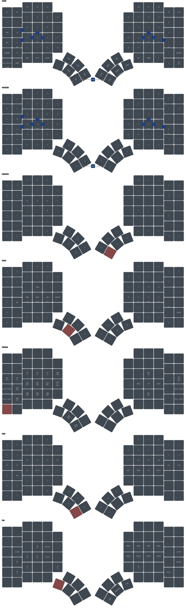

# zmk-config-glove80

ZMK firmware config for the MoErgo Glove80 split keyboard. It holds one keymap, its combos, and the
build targets that turn them into a firmware file for each half.

The behaviors the keymap binds are defined in
[zmk-shared](https://github.com/datapointchris/zmk-shared): home-row mods, thumb layer-taps,
Bluetooth tap-dances and window-manager macros. Every board config beside this one includes that
module. This repo carries what only a Glove80 has: its key positions, its layer order, its RGB
controls and its build matrix. [zmk](https://github.com/datapointchris/zmk) is the tool that
builds, draws, checks and flashes it.

## Install

The firmware compiles inside ZMK's own Docker image. `zmk` drives that container.

```bash
# from your package manager: docker, yq (mikefarah's), python3, uv, fzf, and udisks2 on Linux
curl -fsSL https://raw.githubusercontent.com/datapointchris/zmk/main/install.sh | bash  # zmk, linked into ~/.local/bin
uv tool install keymap-drawer                                              # `keymap`, which renders the SVG
uv tool install --index https://pypi.ichrisbirch.com/simple/ keymap-align  # column-aligns the keymap
```

## Starting from scratch

`zmk` finds the shared module as a sibling directory named `shared`. The two clones sit side by
side.

```bash
mkdir -p ~/zmk && cd ~/zmk
git clone https://github.com/datapointchris/zmk-shared shared   # must be named shared, beside the config
git clone https://github.com/datapointchris/zmk-config-glove80 glove80
cd glove80

zmk check                                    # files, drawing, build targets, shared module, tools
zmk build                                    # fetches the west workspace once, then builds every target
zmk flash glove80_lh_linux glove80_rh_linux  # or the _macos pair; one half at a time
```

`zmk check` exits 1 on any error. It reports every missing file and tool in one run rather than
stopping at the first.

The first build fetches a west workspace of several gigabytes into `~/.cache/zmk/glove80/`. The
directory is named after the config checkout. Later builds are incremental. An edit to
`config/west.yml` runs `west update` on the next build without being asked. Each firmware lands in
the repo root as `<artifact-name>.uf2`, which git ignores.

`zmk flash` waits for a bootloader drive to appear, checks it for `INFO_UF2.TXT`, then copies the
file. Its prompt says to double-tap reset. On this keymap the bootloader is a key. Hold SYSTEM and
press the outermost home-row key on the half being flashed: the key that is Esc on the left, or `'`
on the right. That key reboots the half it sits on, whichever hand holds SYSTEM. It exists only
once this keymap is on the board, so a first flash uses the running firmware's own way in. Each
half gets 60 seconds to appear. `ZMK_FLASH_TIMEOUT` changes that.

## Layers — a layer's number is its block's position in the keymap, not its define



| # | Layer | Reached by | Holds |
| --- | --- | --- | --- |
| 0 | BASE | default | QWERTY with home-row mods, the number row, F1–F10 |
| 1 | COLEMAK | both inner lower thumbs together, as a toggle | Colemak-DH letters and their home-row mods; every other key falls through to BASE |
| 2 | DEVLEFT | holding Enter or Space on the right lower thumbs | programming symbols under the left hand |
| 3 | NPAD | holding Backspace on the left lower thumb | number pad on the right; Home, End, Page Up, Page Down and Insert on the left |
| 4 | SYSTEM | holding the outer key of the bottom letter row on either side, or holding `magic` | Bluetooth profiles, USB or BLE output, RGB, media, bootloader and reset |
| 5 | NAV | holding Delete on the inner left lower thumb | arrows on the right home row, F1–F12 across the row above, plain modifiers on the left |
| 6 | WM | holding the outermost left lower thumb | window-manager chords: focus and move on HJKL, workspaces on letters |

Home-row mods run GASC from the pinky inward: GUI, Alt, Shift, Ctrl, mirrored on the right. On
the letter layers, Shift uses a faster variant than the other three.

`magic` is the bottom-left key. Held, it opens SYSTEM. Tapped, it overlays the keyboard's status on
the underglow: each half's battery, the active layers, the Bluetooth profiles, the USB connection
and the lock keys. That overlay is `RGB_STATUS`, which exists only in MoErgo's fork.

The combos fire on BASE and COLEMAK alike. They are bound to positions, so they stay on the same
physical keys under either layout. Adjacent home-row pairs type brackets: S+D `[`, D+F `(`, S+F
`{`, then J+K `)`, K+L `]`, J+L `}`. A+S types `_`, L+; types `-`, and Q+W types `~`. Each combo
needs 150 ms of idle before it, so a pair pressed mid-word types both letters.

Key positions follow the Glove80's own numbering, which is not sequential across the halves.
`KEYS_L`, `KEYS_R`, `THUMBS_L` and `THUMBS_R` at the top of the keymap list them per hand. They
must be defined before `shared_behaviors.dtsi` is included, because every shared hold-tap names
them as its trigger positions. A 42-key board's positions do not carry over.

A layer's number comes from where its block sits in `keymap`. The `#define` at the top only names
that number. A layer inserted anywhere but last leaves every later define pointing at the wrong
block. Nothing errors.

## Two firmwares per half — the OS is fixed when the firmware is built

```bash
zmk flash glove80_lh_linux glove80_rh_linux   # WM chords on Super, for i3 or sway
zmk flash glove80_lh_macos glove80_rh_macos   # WM chords on Alt, for AeroSpace
```

`build.yaml` builds each half twice. The macOS targets pass `-DOS_MACOS` to the devicetree
preprocessor. zmk-shared's `WMK()` and `WMSK()` macros resolve on that flag: Alt and Alt+Shift on
macOS, Super and Super+Shift on Linux. Nothing on the keyboard switches between them. Changing OS
means flashing the other pair.

Two WM keys call `LG()` directly, so they send GUI on both builds: the keys drawn CLOSE (`LG(Q)`)
and SCRATCH (`LG(GRAVE)`). On macOS the close key is Cmd+Q.

The other boards that include zmk-shared switch OS at runtime through conditional layers. This
keymap has no `OS_MAC_LAYER`, so none of that applies here.

## Building — local builds see `../shared` live; CI sees only what is pushed

```bash
zmk sync              # align the keymap, redraw the SVG, build every target
zmk check             # after a keymap edit: does the drawing still match it?
zmk build --pristine  # after a cmake-args change, which the build cache would otherwise keep
zmk --help            # every command
```

`zmk` bind-mounts the sibling `shared/` into the build container. An edit there reaches the next
local build with no commit. CI has no such mount. It resolves zmk-shared through
`config/west.yml`, from GitHub at `main`. A change spanning both repos therefore pushes zmk-shared
first. Otherwise the board's CI run compiles against a `main` that lacks the change. A fork that
changes shared behaviors points the `datapointchris` remote in `config/west.yml` at its own copy.

Every push builds on GitHub Actions. Each run attaches one `firmware` artifact holding a `.uf2` per
`build.yaml` entry. A fork with no Docker can flash from that.

`glove80_keymap.yaml`, the drawing's source, is written by hand. A keymap edit never reaches the
drawing by itself, and the SVG still renders cleanly. `zmk check` is what notices. It compares
every cell by class: a key, transparent, or none. It also checks that each key opening a layer is
labeled with that layer. Other labels are free text, so it does not compare them. `zmk sync`
redraws from the YAML without checking it.

`--pristine` wipes only the build directories. A bad CMake flag persists in their cache until then.
`zmk clean` is the heavier reset. It deletes this repo's whole west workspace, and the next build
fetches it again.

## The MoErgo fork — the Glove80 board exists nowhere else

`config/west.yml` pins `moergo-sc/zmk` at `main` rather than upstream `zmkfirmware/zmk`. The
`glove80_lh` and `glove80_rh` boards are defined only in that fork. Pointing the manifest at
upstream breaks the build.

CI calls MoErgo's reusable workflow for the same reason. Upstream's workflow on `main` assumes
Zephyr 4.1's board-variant scheme. Its compatibility check asks `west boards` for a `{qualifiers}`
field the fork's older Zephyr does not have.

`config/glove80.conf` turns on ZMK's pointing support with smooth scrolling. No layer binds a
pointing key. Everything else comes from the fork's board definitions. The one `.conf` applies to
both halves.
